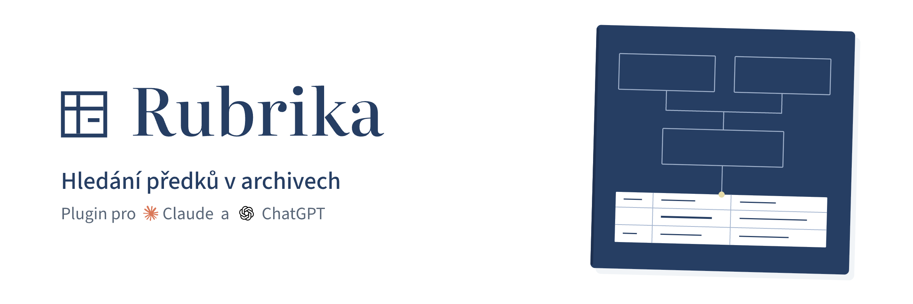

**Od jména a obce k původnímu zápisu v českém archivu.**

[](LICENSE)


Rubrika je bezplatný plugin pro Claude a ChatGPT/Codex s **připravenými přístupy k českým
archivům**. Pomůže vybrat správnou knihu, otevřít původní sken a uložit nález tak, abyste
se k jeho podkladu mohli kdykoli vrátit. Vedle matrik propojí pátrání s prameny o domech,
parcelách a domácnostech.

Napíšete Claudovi nebo ChatGPT, koho hledáte, třeba:

> Najdi narození mého praděda Jana Nováka ve Znojmě kolem roku 1843. Kdo tehdy vlastnil
> jeho rodný dům a kdo v něm bydlel při sčítání lidu v roce 1869?

**Obsah:** [Co vám Rubrika usnadní](#co-vám-rubrika-usnadní) · [Kde Rubrika hledá](#kde-rubrika-hledá) · [Instalace](#instalace) · [Jak začít](#jak-začít) · [Jaký model použít](#jaký-model-použít) · [Soukromí a pravidla](#soukromí-a-pravidla) · [Když něco nefunguje](#když-něco-nefunguje) · [Stav projektu](#stav-projektu) · [English](#english)

## Co vám Rubrika usnadní

- **Připravené hledání v sedmi archivech.** Z jedné konverzace vyhledáte obec i pod
  historickým názvem, příslušné knihy a jejich snímky. Rozsah se liší podle archivu;
  Třeboň poskytuje katalog a odkazy. Podrobnosti jsou v [přehledu pramenů](#kde-rubrika-hledá).
- **Nález, který můžete zkontrolovat.** Asistent listuje původními skeny a přibližuje
  rukopis. K přečtenému zápisu uloží výřez, přepis, citaci a odkaz na zdroj; nejistá
  místa má označit. Můžete tak porovnat jeho čtení s obrazovým dokladem.
- **Rodina, dům i domácnost.** K narození nebo sňatku můžete dohledat obyvatele domu
  při sčítání, držitele parcely nebo převod usedlosti v pozemkové knize. Dostupné
  prameny pomáhají sledovat rodinu i mezi jednotlivými matričními zápisy.
- **Pokračování s uloženými doklady.** Hledání, nálezy a výřezy zůstávají na vašem
  počítači. V další konverzaci navážete na uložený stav a výsledky můžete exportovat
  jako GEDCOM pro genealogické programy. Na požádání je asistent uloží jako balíček
  pro rodinu: GEDCOM s výřezy zápisů, stránku, která se otevře v prohlížeči, a ZIP.
  Řekne vám také, kde linie končí a co v ní ještě chybí.

Začít můžete jménem, obcí a přibližným obdobím, bez znalosti čísel matrik a fondů.
Asistent vám pomůže i se čtením kurentu; správnost přepisu je potřeba ověřit proti skenu.

## Kde Rubrika hledá

| Archiv | Území | Matriky | Pozemkové knihy a katastry | Sčítání a soupisy obyvatel |
|---|---|---|---|---|
| [Moravský zemský archiv](https://www.mza.cz) (MZA) | Morava a část Vysočiny | ✓ | ✓ včetně stabilního katastru a indikačních skic | ✓ 1857–1910 |
| [SOA Hradec Králové](https://aron.vychodoceskearchivy.cz/) | Královéhradecký a Pardubický kraj, Havlíčkobrodsko a Semilsko | ✓ | městské pozemkové knihy | ✓ |
| [SOA Plzeň](https://www.portafontium.eu/) (Porta fontium) | Plzeňský a Karlovarský kraj | ✓ | úřední a pozemkové knihy | ✓ 1869–1921 |
| [SOA Praha](https://ebadatelna.soapraha.cz/) (eBadatelna) | Středočeský kraj | ✓ | pozemkové knihy měst a panství | ✓ 1869–1910, vybrané okresy |
| [Archiv hlavního města Prahy](https://katalog.ahmp.cz/pragapublica/) | Praha | ✓ | – | ✓ sčítání 1869–1890, soupis obyvatelstva 1830–1910 |
| [Národní archiv](https://vademecum.nacr.cz/vademecum/) | Čechy, Morava a část Slezska | židovské matriky 1784–1949 | – | pražské policejní přihlášky 1850–1914 |
| [SOA Třeboň](https://digi.ceskearchivy.cz/) (DigiArchiv) | Jihočeský kraj | jen katalog a odkazy | jen katalog a odkazy | jen katalog a odkazy |

**Jen odkaz:** Zemský archiv v Opavě, SOA Litoměřice a Archiv map ČÚZK (indikační skici Čech
a Slezska) Rubrika neprohledává, protože jejich portály automatizovaný přístup nepouštějí.
Asistent vám dá odkaz. Snímek z nich (i z Třeboně) si uložíte v prohlížeči a Rubrika ho
načte jako doklad. Sčítání z roku 1921 zpřístupňuje MZA jen ve svých badatelnách.

Co který pramen obsahuje, jak se v něm hledá, jak předat snímek z prohlížeče a za jakých
podmínek archivy snímky zpřístupňují (včetně Porta fontium a § 92 autorského zákona):
**[Archivy a jejich podmínky](docs/ARCHIVY.md)**.

## Instalace

Rubrika běží na vašem počítači. Nainstalovat ji můžete do Claude Desktop, Claude Code,
Codexu nebo desktopové aplikace ChatGPT.

Nejjednodušší je **Claude Desktop**, který si vše potřebné stáhne sám. Ostatní aplikace
potřebují navíc pomocné programy `uv` a `git`. Po instalaci v kterékoli aplikaci začněte
**novou konverzaci**; do rozpracované se Rubrika nenačte.

**V Claude Code nebo Codexu to za vás udělá asistent.** Napište mu:

> Nainstaluj mi prosím Rubriku podle https://github.com/j-necas/rubrika/blob/main/docs/INSTALACE-AGENT.md

Než cokoli nainstaluje, zeptá se vás na souhlas. Postup, kterým se řídí, je
v [návodu pro asistenta](docs/INSTALACE-AGENT.md); ručně postupujte podle oddílů níže.

### Claude Desktop

1. Z [posledního vydání](https://github.com/j-necas/rubrika/releases/latest) stáhněte
   `rubrika.mcpb` a `rubrika-skill.zip`.
2. Soubor `rubrika.mcpb` otevřete dvojklikem a v Claude potvrďte instalaci. Claude si přitom
   sám stáhne vše potřebné (Python a knihovny); první instalace může trvat pár minut.
3. Nahrajte skill, který Claudovi říká, jak při hledání postupovat: v Claude otevřete
   **Customize → Skills**, klikněte na **+ → Create skill → Upload a skill** a vyberte
   `rubrika-skill.zip`. Nahraný skill musí mít zapnutý přepínač a v nastavení musí být
   zapnuté **Code execution and file creation**.

**Nová verze:** z posledního vydání stáhněte znovu oba soubory. Otevřete nový `rubrika.mcpb`
a v **Customize → Skills** starý skill Rubriky smažte a nahrajte nový `rubrika-skill.zip`.
Vaše hledání a nálezy ve složce `Rubrika` zůstanou.

### Claude Code, Codex a ChatGPT: nejdřív `uv` a `git`

Tady Rubrika potřebuje malý pomocný program [uv](https://docs.astral.sh/uv/), který obstará
Python a knihovny, a program `git`, kterým aplikace stáhne plugin z GitHubu.

**Windows.** V PowerShellu nainstalujte `uv` i `git`:

```powershell
powershell -ExecutionPolicy ByPass -c "irm https://astral.sh/uv/install.ps1 | iex"
winget install Git.Git
```

**Mac.** V Terminálu nainstalujte `uv`:

```bash
curl -LsSf https://astral.sh/uv/install.sh | sh
```

Program `git` na Macu obvykle je; když chybí, při prvním použití Mac sám nabídne instalaci
vývojářských nástrojů a stačí ji potvrdit.

Pak otevřete **nový** terminál a ověřte, že `uv --version` i `git --version` vypíšou číslo
verze. Nakonec aplikaci, ve které budete Rubriku používat, úplně ukončete a znovu spusťte.

### Claude Code

V Claude Code zadejte:

```
/plugin marketplace add j-necas/rubrika
/plugin install rubrika@rubrika
```

**Nová verze:** pluginy z GitHubu se samy neaktualizují. V terminálu zadejte

```bash
claude plugin marketplace update rubrika
claude plugin update rubrika@rubrika
```

a spusťte Claude Code znovu (v běžící relaci stačí `/reload-plugins`).

### Codex

V terminálu zadejte:

```bash
codex plugin marketplace add j-necas/rubrika
codex plugin add rubrika@rubrika
```

Pak spusťte `codex` znovu. Nainstalované pluginy uvidíte a můžete je zapnout či vypnout
v Codexu příkazem `/plugins`. Při úplně prvním spuštění si Rubrika připravuje prostředí
déle, než Codex čeká: když asistent napíše, že nástroje Rubriky nemá, počkejte minutu
a začněte novou konverzaci.

**Nová verze:** `codex plugin marketplace upgrade rubrika`, pak spusťte `codex` znovu.

### Desktopová aplikace ChatGPT

Pluginy v aplikaci ChatGPT fungují v části **Codex**, ne v běžném chatu. Aplikace je sdílí
s Codexem v terminálu, a marketplace se proto přidává jeho příkazem:

1. Nainstalujte Codex do terminálu. Ve Windows (PowerShell):
   ```powershell
   powershell -ExecutionPolicy ByPass -c "irm https://chatgpt.com/codex/install.ps1 | iex"
   ```
   Na Macu:
   ```bash
   curl -fsSL https://chatgpt.com/codex/install.sh | sh
   ```
2. V novém terminálu zadejte `codex plugin marketplace add j-necas/rubrika`.
3. ChatGPT úplně ukončete a znovu spusťte, přepněte se do Codexu, otevřete **Plugins**,
   vyberte marketplace **Rubrika** a nainstalujte plugin `rubrika`.

**Nová verze:** v terminálu `codex plugin marketplace upgrade rubrika`, pak ChatGPT úplně
ukončete a znovu spusťte.

## Jak začít

Matriky často sahají až do 17. století; veřejně přístupné jsou zápisy o narození starší sta let.
Nejlépe se proto začíná u předka z 19. století, o kterém víte jméno a obec.

Začněte novou konverzaci a napište, koho hledáte. Pomůže, když uvedete:

- **jméno** osoby (i s variantami příjmení, pokud je znáte),
- **obec**, nejlépe i s okresem nebo farností (*„Lhota u Vyškova“*, ne jen *„Lhota“*),
- **událost** (narození, sňatek, úmrtí) a **přibližné roky**,
- cokoli dalšího, co víte: jména rodičů, manželky, číslo domu.

Příklady (první je skutečné zadání, další jsou ilustrační):

> Vyhledej v matrikách Malých Svatoňovic narození Karla Čapka 9. ledna 1890

Přesně touto větou jsme Rubriku zkoušeli: asistent našel zápis na snímku 112 matriky narozených
v Hradci Králové a správnost přepisu jsme ověřili proti snímku. Stručné zadání stačí; víc údajů
hledání zpřesní.

> Můj praděda Jan Novák se narodil kolem roku 1880 ve Lhotě u Vyškova. Otec se jmenoval Josef.
> Najdi jeho narození a pokračuj po otcovské linii, jak daleko to půjde.

> Kdo vlastnil dům č. 12 ve Slavkově u Brna v 18. století?

> Kdo žil v roce 1880 v domě č. 7 v Kroměříži?

> Z uložených nálezů mi sestav rodokmen přímé linie a dej mi ho jako GEDCOM.

### Jak pátrání probíhá

1. **Asistent hledá a čte.** Vybere matriku, listuje snímky, přečte zápis a ukáže výřez
   s přepisem. Když si čtením není jistý, řekne to.
2. **Pokračuje o generaci zpět.** Ze zápisu zjistí rodiče, v 19. století často i prarodiče
   a číslo domu, a hledá jejich narození a sňatek. Pozemkové knihy doplní, kdo držel dům.
3. **Vy kontrolujete a rozhodujete.** Výřezy porovnáte s originálem, určíte, kterou větví
   pokračovat, a nakonec si řeknete o rodokmen pro genealogické programy (GEDCOM).

Rozsáhlejší pátrání se může rozložit do více konverzací. Asistent hledání uloží a řekne vám
jeho číslo (`research_id`); v nové konverzaci stačí napsat *„pokračuj v hledání search_…“*.

**Výsledky ověřujte.** Asistent čte staré rukopisy dobře, ale ne bezchybně. Každý nález má
výřez a odkaz na sken v archivu, takže si ho snadno zkontrolujete. Nenalezení záznamu
neznamená, že osoba neexistovala.

## Jaký model použít

Doporučujeme **Claude Sonnet 5.5** nebo **Opus 5.5** se střední (`medium`) nebo vyšší úrovní
uvažování. Vyzkoušeli jsme to na dvou skutečných zadáních: narození Karla Čapka a kmotři
T. G. Masaryka (německý zápis kurentem). Hodnotili jsme správnost a úplnost odpovědi proti
snímku, 10 je úplný a přesný přepis.

| Model | Kvalita | Verdikt |
|---|---|---|
| Claude Opus 5.5 | 9,0 | doporučeno: nejúplnější přepisy |
| Claude Sonnet 5.5 | 8,5 | doporučeno: nejpřesnější, nejistotu přizná |
| GPT-6-Astra | 7,5 | použitelné: správné hlavní údaje, méně podrobností |
| GPT-6.1-Sol | 4,5 | použitelné, ale ověřujte: kmotry uvedl jinak než ostatní |
| Claude Haiku 5.5 | 3,0 | nevhodné: bez pokynu Rubriku nepoužije, zápis nedočte |
| GPT-6-Luna | 2,5 | nevhodné: opírá se o weby místo o snímek |

Nalezení jednoho zápisu trvalo zhruba **6 až 8 minut**. Pátrání je **náročné na tokeny**
(asistent čte snímky jako obrázky), takže jedno hledání může spotřebovat velkou část limitu
tarifu. Zadávejte konkrétní osobu, obec a roky a rozsáhlé pátrání rozdělte do více konverzací.

Jednotlivá zadání, rychlost, vliv úrovně uvažování a metodika: **[Srovnání modelů](docs/MODELY.md)**.

## Soukromí a pravidla

Rubrika nemá žádný vlastní server ani účty a neobsahuje analytiku ani jiné sledování.
Autor Rubriky od vás nedostává nic: co hledáte, co najdete ani kdo jste. Údaje, které
při hledání vznikají, putují takto:

| Kdo | Co vidí |
|---|---|
| **Váš počítač** | Hledání, nálezy a výřezy skenů ve složce `Rubrika` ve vašem domovském adresáři. Nic se nemaže samo; složku můžete kdykoli smazat. |
| **Poskytovatel AI** – Anthropic (Claude), nebo OpenAI (ChatGPT, Codex) | Celou konverzaci: co napíšete (jména, data, rodinné vztahy), výsledky nástrojů Rubriky i výřezy skenů. Zpracovává je podle svých zásad ochrany osobních údajů ([Anthropic](https://www.anthropic.com/legal/privacy), [OpenAI](https://openai.com/policies/privacy-policy/)) a podle nastavení vašeho účtu, například zda dovolíte použít konverzace ke zlepšování modelů. |
| **Archiv** | Dotazy do katalogu (název obce, období, číslo knihy) a žádosti o snímky, z vaší IP adresy, stejně jako když archiv prohlížíte v prohlížeči. Vaše poznámky archivu Rubrika neposílá. Jméno hledané osoby posílá jen tam, kde se podle něj hledá: do Soupisu pražského obyvatelstva AHMP a do policejních přihlášek Národního archivu (ty [nešifrovaně](docs/ARCHIVY.md#podmínky-jednotlivých-archivů)). |
| **Autor Rubriky** | Nic. GitHub mu ukazuje jen souhrnné statistiky repozitáře, například počet stažení. |

Při instalaci si `uv` (nebo Claude Desktop) stahuje Python a knihovny z veřejných zdrojů,
hlavně z PyPI a GitHubu.

**Pravidla archivů a vaše odpovědnost:**

- **Skeny jsou pro vaše vlastní bádání.** Archivy obvykle dovolují užití pro osobní potřebu
  a zveřejnění podmiňují svým souhlasem. Instalací přebíráte
  [podmínky užití aplikací MZA](https://www.mza.cz/aplikace/podminky-pouziti-aplikace-aron/);
  podmínky ostatních archivů jsou v [přehledu archivů](docs/ARCHIVY.md#podmínky-jednotlivých-archivů).
- **Rubrika je nástroj ve vašich rukou.** Běží na vašem počítači a do archivu jde jen na váš
  pokyn a vaším jménem, stejně jako když archiv procházíte sami. Autor poskytuje software
  zdarma a bez záruky; neprovozuje službu, která by přijímala vaše hledání nebo snímky.
- **Ohleduplně k archivům.** Rubrika klade dotazy pomalu, má denní stropy a mezipaměť,
  nestahuje celé knihy, představuje se archivu jménem projektu a nikdy neobchází přihlášení
  ani ochranu proti robotům. U AHMP a Národního archivu, jejichž robots.txt automatický
  přístup zakazuje, požadavky na vaše zadání přesto provádí; je to výslovná politika
  projektu, nikoli souhlas archivu.
- Doporučujeme v nastavení AI vypnout použití konverzací ke zlepšování modelů.

Celé znění: **[Ohleduplnost k archivům a odpovědnost](docs/PRAVIDLA.md)**.

## Když něco nefunguje

| Potíž | Řešení |
|---|---|
| Asistent říká, že nemá nástroje Rubriky | V Claude Desktop zkontrolujte v Nastavení → Extensions, že je Rubrika zapnutá; první spuštění může trvat minutu či dvě. V Claude Code, Codexu a ChatGPT ověřte v novém terminálu, že `uv --version` vypíše verzi; pak aplikaci úplně ukončete a znovu spusťte. |
| Asistent nenašel obec | Uveďte okres, farnost nebo sousední obec, případně historický (německý) název. |
| Asistent nenašel osobu | Rozšiřte roky, zkuste varianty příjmení nebo sousední farnost; zápis může být i v rejstříku. |
| Archiv hlásí nedostupnost nebo limit | Chvíli počkejte; Rubrika omezení archivu záměrně neobchází. |
| Plugin nejde přidat ve firemním účtu | Správce firemního účtu Claude nebo ChatGPT (Team, Business, Enterprise) může pluginy z GitHubu nebo nahrávání skillů zakázat; obraťte se na něj. |

## Stav projektu

Rubrika je verze pro vyzkoušení (0.14.0). Hledání v MZA (matriky, pozemkové knihy, sčítací operáty,
stabilní katastr) je vyzkoušené na skutečných datech. Hledání ve všech ostatních archivech
je ověřené na živých archivech od hledání po otevření snímku (u Třeboně jen katalog a odkazy).
Automatické testy běží na Linuxu, macOS i Windows.
Archivy, jejich podmínky a co v nich Rubrika umí: [archivy](docs/ARCHIVY.md).

Chcete přispět nebo nahlásit chybu? Viz [jak přispět](CONTRIBUTING.md) a
[dokumentace pro vývojáře](docs/DEVELOPMENT.md). Bezpečnostní problémy hlaste
podle [bezpečnostních pokynů](SECURITY.md). Veřejná hlášení nesmějí obsahovat vaše rodinná data.

## Licence

Kód je pod licencí [MIT](LICENSE). Licence se nevztahuje na archivní materiál. Rubrika je
nezávislý projekt, není službou ani produktem Moravského zemského archivu.

## English

Rubrika is a free plugin for Claude and ChatGPT/Codex with built-in access to digitised Czech archives
(parish registers, land records, cadastral maps, censuses). It helps locate original scans and saves findings with
image crops, transcriptions and source citations, so research can continue across conversations and be exported as GEDCOM
(on request also as a family package: GEDCOM with the crops, a standalone HTML page and a ZIP, saved on your own disk).
It searches seven archives: the Moravian Land Archive (MZA),
the State Regional Archives in Hradec Králové, Plzeň (Porta fontium), Prague (eBadatelna) and Třeboň (DigiArchiv,
catalogue and links only), the Prague City Archives and the National Archives (Jewish registers, Prague police
registrations). Scans saved from the browser can be imported as evidence. Other archives are only linked, not
searched. The documentation is in Czech.
